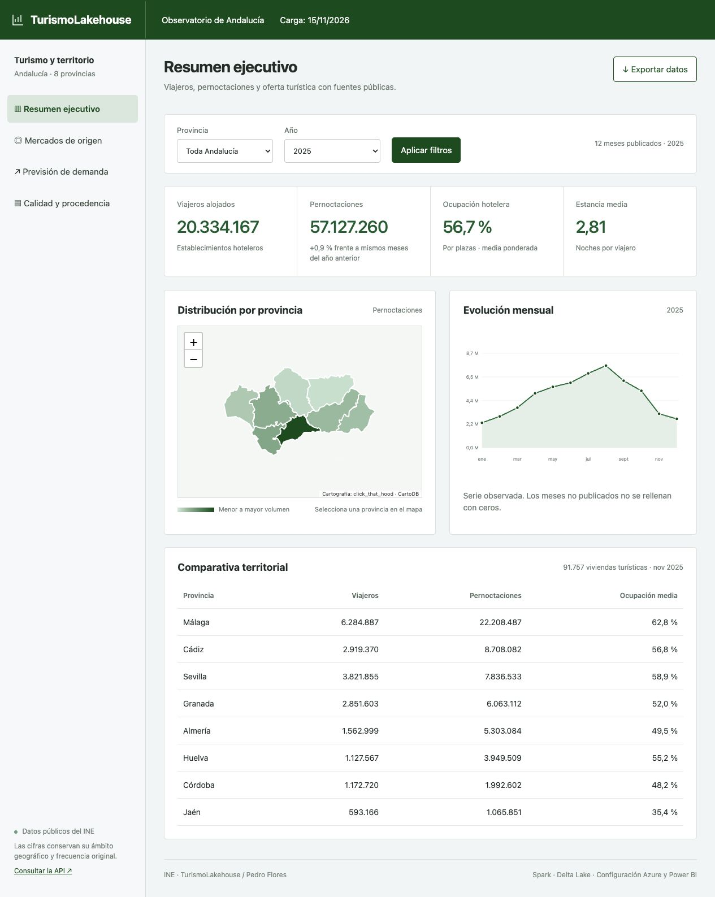
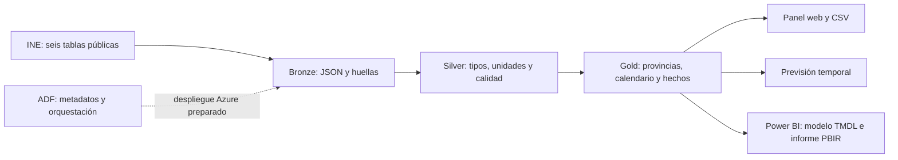

# TurismoLakehouse

Datos turísticos de Andalucía desde las fuentes públicas hasta un modelo analítico: ingesta, tablas Delta, controles de calidad, previsiones y un panel para consultar ocho provincias.

**Python · PySpark · Delta Lake · Azure Data Factory · Databricks · Terraform · Power BI**



## Qué puedes probar en un minuto

- Filtrar viajeros, pernoctaciones, estancia y ocupación hotelera por provincia y año.
- Explorar el mapa y exportar las observaciones a CSV.
- Comparar mercados internacionales, conservando su ámbito regional.
- Revisar una previsión de seis meses, su error fuera de muestra y la procedencia de cada fuente.

```sh
docker compose up --build -d web
```

Abrir **http://localhost:5102**. El panel arranca con una captura real incluida en `data/gold`; no necesita cuentas ni claves. [Recorrido visual](docs/demo.gif) · [API](http://localhost:5102/docs).

## Cómo está construido



| Carpeta | Responsabilidad |
|---|---|
| `tourism/` | Ingesta, MERGE Delta, controles, previsión, API y panel |
| `adf/` | Pipeline y datasets con fuentes parametrizadas |
| `databricks/` | Notebook, paquete y definición del job |
| `infra/` | ADLS Gen2, ADF, Key Vault, Databricks y permisos Unity Catalog |
| `powerbi/` | Cuatro páginas, modelo estrella, medidas DAX y ocho roles provinciales |
| `tests/` | Calidad, Delta real, series temporales, filtros y exportación |

## Resultados comprobados

Captura del 15 de noviembre de 2026. Hoteles: **octubre de 2021 a septiembre de 2026**, 480 observaciones provincia/mes. Las otras fuentes mantienen sus frecuencias y períodos propios.

| Comprobación local | Resultado |
|---|---|
| Bronze / Silver | 67.908 / 58.788 filas; siete controles superados |
| Repetición con la misma captura | Mismas filas; 80,685 s iniciales / 37,346 s repetición |
| Pipeline completo dentro de Docker | 31,374 s; mismos recuentos y siete controles superados |
| Pruebas automáticas | 11 superadas, incluida actualización e inserción en Delta real |
| Modelo Power BI | Deserializado con TOM: 8 tablas, 9 relaciones, 8 roles |
| Informe PBIR | 27 archivos validados con los esquemas oficiales de Microsoft |
| Terraform | Inicializado y validado; sin aplicar recursos |

La previsión compara una base estacional con suavizado exponencial. Separa 36 meses de entrenamiento, 12 de selección/calibración y 12 de prueba. La cobertura observada de los intervalos nominales del 90 % varía entre **58,3 % y 91,7 %**: son orientativos y requieren mejorar su calibración. [Métricas por provincia](data/gold/forecast-metrics.json) · [Idempotencia](docs/pipeline-idempotence.json).

## Ejecutar el procesamiento

Python 3.12, Java 21 y [uv](https://docs.astral.sh/uv/).

```sh
uv sync --extra etl --extra test --frozen
uv run tourism-pipeline --root lake
uv run tourism-pipeline --root lake --offline
uv run pytest -q
```

También: `docker compose --profile etl run --build --rm pipeline`. La primera ejecución descarga las seis tablas INE; las siguientes pueden reutilizar `lake/raw`. El panel incluido sirve la captura publicada: para ver una nueva carga, inicia la API con `TOURISM_EXPORT_DIR=lake/exports` y conserva `lake/source-manifest.json` junto a esa carpeta. Reinicia la API después de actualizar los CSV.

## Power BI y Azure

Abrir `powerbi/Turismo.pbip` en Power BI Desktop para Windows. Las consultas M leen los CSV públicos de este repositorio con acceso anónimo; se pueden cambiar por las tablas Gold del despliegue. [Modelo, medidas, RLS y comprobaciones](powerbi/README.md).

**Probado aquí:** Spark y Delta locales, panel web, API, esquema PBIR y lectura del modelo TMDL. **Pendiente de entorno externo:** apertura y renderizado en Power BI Desktop, evaluación DAX/RLS en su motor y ejecución en Azure/Databricks. El panel de las imágenes es la aplicación web; no se presenta como una captura de Power BI.

La infraestructura está preparada, sin recursos activos ni cargos. [Despliegue y limpieza](docs/deployment.md) · [Estimación de costes](docs/costs.md). `allow_billable_resources=false` bloquea la activación accidental y el disparador mensual está deshabilitado.

## Fuentes y límites

Elaboración propia con datos extraídos del sitio web del **INE**. [Manifiesto: URLs, fechas y SHA-256](data/source-manifest.json). El gasto por país es **anual y regional**; no permite calcular gasto británico en una provincia. La vivienda turística es una observación semestral y no se interpola a meses. Los valores no publicados siguen vacíos; los años parciales se comparan con los mismos meses del anterior.

El adaptador AEMET requiere clave y selección de estaciones; no hay meteorología cargada en la demo. No se inventan observaciones. Los intervalos provinciales sumados no constituyen un intervalo conjunto calibrado.

Código [MIT](LICENSE). Atribuciones y condiciones de los datos en [NOTICE.md](NOTICE.md).
